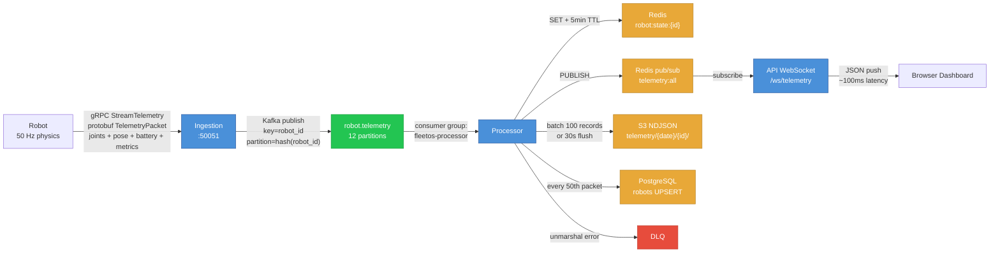
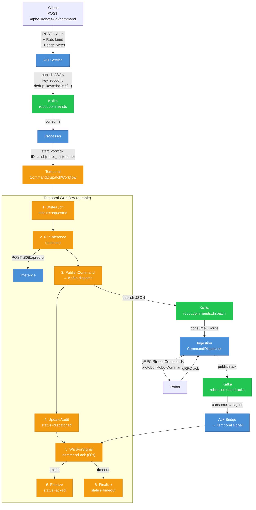
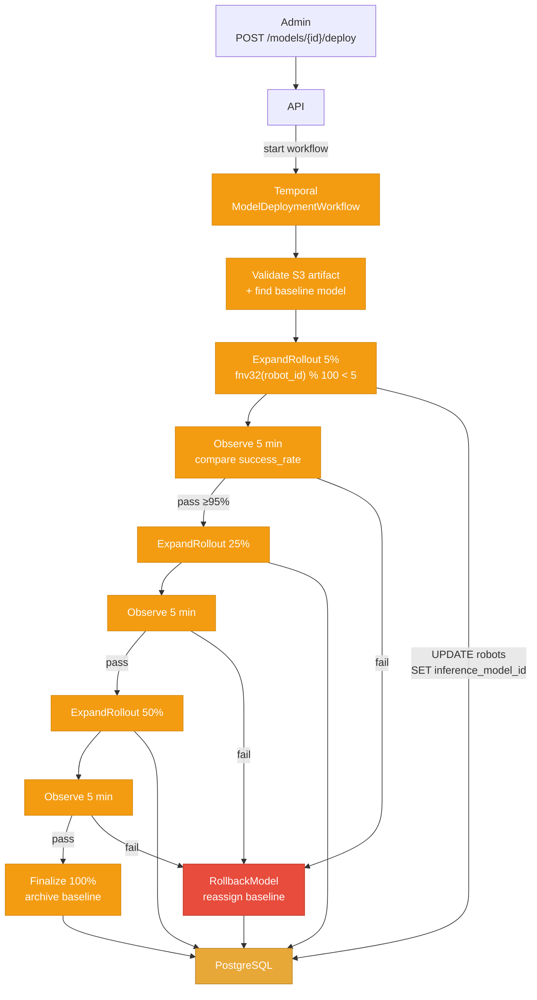
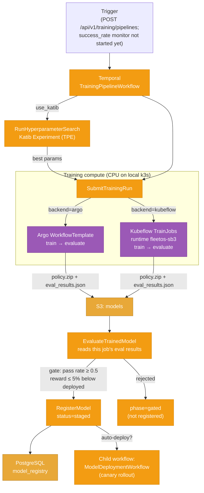
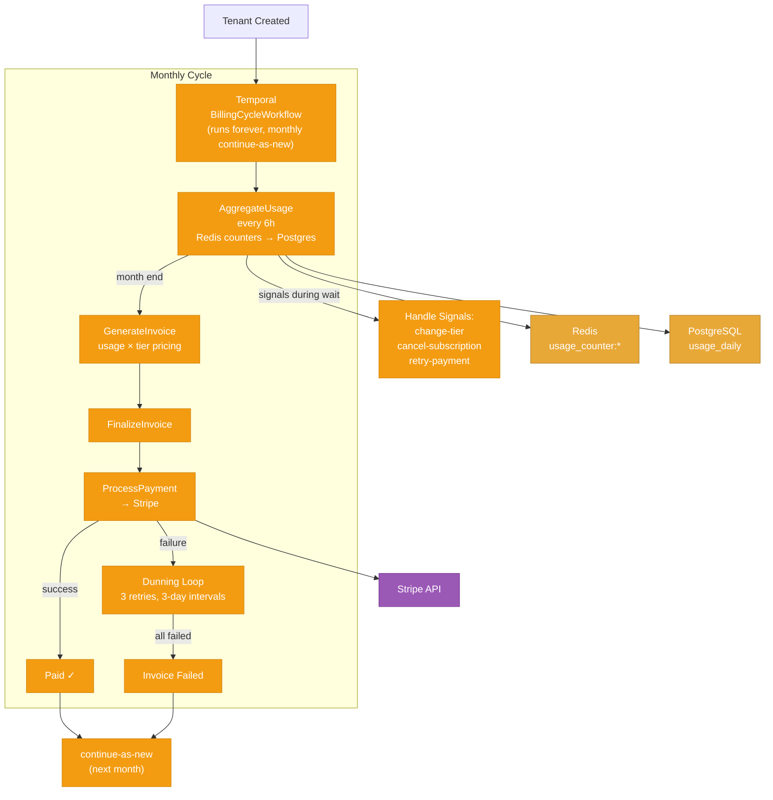
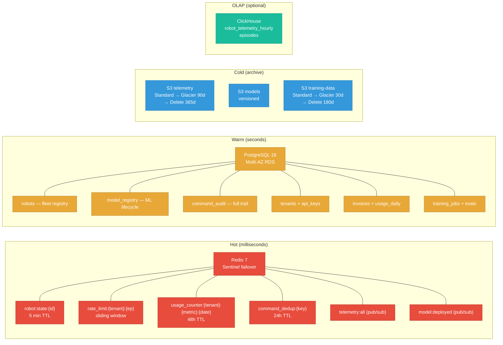

# FleetOS Production Architecture

## System Overview

```mermaid
graph TD
    %% ============================================================
    %% EXTERNAL ACTORS
    %% ============================================================
    subgraph External["External"]
        ROBOTS["Humanoid Robot Fleet<br/>(MuJoCo Simulators)"]
        CLIENTS["Clients<br/>(Browsers, SDKs, Admin Console)"]
        STRIPE["Stripe API<br/>(Payments)"]
    end

    %% ============================================================
    %% NETWORKING / INGRESS
    %% ============================================================
    subgraph Networking["Networking & Ingress"]
        R53["Route53 DNS<br/>api / grpc / grafana"]
        ACM["ACM Wildcard Cert<br/>*.fleetos.dev"]
        ALB["ALB<br/>HTTPS :443"]
        NLB["NLB<br/>TCP :50051"]
        ISTIO_GW["Istio Ingress Gateway<br/>mTLS STRICT"]
    end

    R53 --> ALB
    R53 --> NLB
    ACM --> ALB
    ALB --> ISTIO_GW
    NLB --> ISTIO_GW

    %% ============================================================
    %% PLATFORM SERVICES (EKS)
    %% ============================================================
    subgraph Platform["Platform Services (EKS — Helm via ArgoCD)"]
        INGESTION["Ingestion Service<br/>Go :50051 gRPC<br/>2-10 replicas (HPA 70%)"]
        API["API Service<br/>Go :8080 REST + WS<br/>3-20 replicas (HPA 60%)"]
        PROCESSOR["Processor Service<br/>Go (Kafka consumer)<br/>2-8 replicas (HPA 70%)"]
        WORKER["Worker Service<br/>Go (Temporal worker)<br/>2 replicas"]
        INFERENCE["Inference Service<br/>Python :8081 HTTP<br/>1-5 replicas (HPA 70%)"]
    end

    %% ============================================================
    %% KAFKA MESSAGING
    %% ============================================================
    subgraph Kafka["Kafka (MSK — 3 brokers, partitioned by robot_id)"]
        KT_TEL["robot.telemetry<br/>protobuf, 10 Hz/robot"]
        KT_CMD["robot.commands<br/>JSON, on-demand"]
        KT_DISPATCH["robot.commands.dispatch<br/>JSON, on-demand"]
        KT_ACK["robot.command-acks<br/>JSON, on-ack"]
        KT_DEPLOY["deployment.events<br/>JSON, on-deploy"]
        KT_DLQ["robot.telemetry.dlq<br/>❌ Dead Letter Queue"]
    end

    %% ============================================================
    %% STORAGE
    %% ============================================================
    subgraph Storage["Storage Layer"]
        PG[("PostgreSQL 16 (RDS)<br/>Multi-AZ, encrypted<br/>robots, models, commands,<br/>tenants, invoices, api_keys")]
        REDIS[("Redis 7 (ElastiCache)<br/>Sentinel failover<br/>hot state 5min TTL,<br/>rate limits, pub/sub")]
        S3_TEL["S3: fleetos-telemetry<br/>NDJSON + video + lidar + audio<br/>→ Glacier 90d → Delete 365d"]
        S3_MOD["S3: fleetos-models<br/>PPO/SAC/CQL policies<br/>versioned"]
        S3_TRAIN["S3: fleetos-training-data<br/>experience (obs,action,reward)<br/>→ Glacier 30d → Delete 180d"]
        CH[("ClickHouse<br/>OLAP analytics<br/>(optional, graceful fallback)")]
    end

    %% ============================================================
    %% ORCHESTRATION
    %% ============================================================
    subgraph Orchestration["Workflow Orchestration"]
        TEMPORAL["Temporal Server<br/>:7233 gRPC<br/>(ECS Fargate + RDS backend)"]
        subgraph TemporalQueues["5 Task Queues"]
            TQ_CMD["fleetos-commands<br/>CommandDispatchWorkflow"]
            TQ_DEPLOY["fleetos-deployments<br/>ModelDeploymentWorkflow<br/>(canary 5%→25%→50%→100%)"]
            TQ_BILLING["fleetos-billing<br/>BillingCycleWorkflow<br/>(monthly, continue-as-new)"]
            TQ_WEBHOOK["fleetos-webhooks<br/>WebhookFanoutWorkflow"]
            TQ_TRAIN["fleetos-training<br/>TrainingPipelineWorkflow"]
        end
        subgraph MLCompute["ML Compute (argo + fleetos-training namespaces)"]
            ARGOWF["Argo Workflows<br/>fleetos-*-training templates<br/>(train → evaluate)"]
            KUBEFLOW["Kubeflow Trainer v2"]
            PYTORCH["TrainJob<br/>runtime fleetos-sb3<br/>(train, then evaluate)"]
            KATIB["Katib HPO<br/>TPE, 4 trials × 2 parallel"]
        end
    end

    %% ============================================================
    %% OBSERVABILITY
    %% ============================================================
    subgraph Observability["Observability"]
        PROM["Prometheus<br/>(Amazon Managed)<br/>29 fleetos_* metrics"]
        GRAFANA["Grafana<br/>(Amazon Managed)<br/>Fleet + API + ML dashboards"]
        OTEL["OpenTelemetry Collector<br/>OTLP traces"]
        ALERTMGR["AlertManager<br/>14 alert rules<br/>→ PagerDuty (critical)<br/>→ Slack (warning)"]
    end

    %% ============================================================
    %% EKS NODE GROUPS
    %% ============================================================
    subgraph EKS["EKS 1.29 (4 Node Groups)"]
        NG_GEN["general<br/>m6i.xlarge<br/>2-10 nodes"]
        NG_GPU["gpu (inference)<br/>g5.xlarge<br/>0-5 nodes"]
        NG_TRAIN["training<br/>g5.2xlarge<br/>0-8, scale-from-zero<br/>(AWS design, not verified)"]
        NG_KAFKA["kafka<br/>r6i.xlarge<br/>3-6 nodes"]
    end

    %% ============================================================
    %% ROBOT → PLATFORM FLOWS
    %% ============================================================
    ROBOTS -->|"gRPC StreamTelemetry<br/>protobuf 10 Hz"| NLB
    ISTIO_GW -->|"gRPC :50051"| INGESTION
    INGESTION -->|"gRPC StreamCommands<br/>protobuf commands"| ROBOTS

    %% ============================================================
    %% CLIENT → PLATFORM FLOWS
    %% ============================================================
    CLIENTS -->|"REST / WebSocket<br/>HTTPS :443"| ALB
    ISTIO_GW -->|"HTTP :8080"| API

    %% ============================================================
    %% INGESTION FLOWS
    %% ============================================================
    INGESTION -->|"publish protobuf<br/>key=robot_id"| KT_TEL
    INGESTION -->|"publish JSON ack"| KT_ACK
    KT_DISPATCH -->|"consume JSON<br/>route to gRPC stream"| INGESTION
    INGESTION -->|"pub/sub fanout"| REDIS

    %% ============================================================
    %% PROCESSOR FLOWS (Kafka → Storage)
    %% ============================================================
    KT_TEL -->|"consume (group:<br/>fleetos-processor)"| PROCESSOR
    KT_CMD -->|"consume (group:<br/>fleetos-command-processor)"| PROCESSOR
    PROCESSOR -->|"SET robot:state:*<br/>5min TTL, 10 Hz"| REDIS
    PROCESSOR -->|"PUBLISH telemetry:all<br/>+ telemetry:{robot_id}"| REDIS
    PROCESSOR -->|"PUT NDJSON batches<br/>100 records or 30s"| S3_TEL
    PROCESSOR -->|"UPSERT robots<br/>every 50th packet"| PG
    PROCESSOR -->|"start workflow"| TEMPORAL
    PROCESSOR -->|"unmarshal error"| KT_DLQ

    %% ============================================================
    %% API FLOWS
    %% ============================================================
    API -->|"publish JSON<br/>key=robot_id"| KT_CMD
    API -->|"rate limit + cache<br/>fail-closed"| REDIS
    API -->|"CRUD all tables"| PG
    API -->|"start workflows<br/>gRPC :7233"| TEMPORAL
    API -->|"POST /predict<br/>HTTP :8081"| INFERENCE
    API -->|"SELECT analytics<br/>(optional)"| CH
    API -->|"WebSocket → Redis<br/>pub/sub subscribe"| REDIS
    KT_DEPLOY -->|"SSE streaming"| API

    %% ============================================================
    %% WORKER FLOWS (Temporal Activities)
    %% ============================================================
    WORKER -->|"poll task queues<br/>gRPC :7233"| TEMPORAL
    WORKER -->|"publish dispatch"| KT_DISPATCH
    WORKER -->|"publish events"| KT_DEPLOY
    KT_ACK -->|"consume → signal<br/>Temporal workflow"| WORKER
    WORKER -->|"audit trail<br/>+ state"| PG
    WORKER -->|"billing counters"| REDIS
    WORKER -->|"POST /predict<br/>via activity"| INFERENCE
    WORKER -->|"process payment<br/>HTTPS"| STRIPE
    WORKER -->|"submit template<br/>Argo Server REST"| ARGOWF
    WORKER -->|"create TrainJob / Experiment<br/>K8s API (namespaced Role)"| KUBEFLOW

    %% ============================================================
    %% INFERENCE FLOWS
    %% ============================================================
    INFERENCE -->|"GET model<br/>policy.zip"| S3_MOD
    INFERENCE -->|"poll robot:state:*<br/>every 5s (FAISS index)"| REDIS
    INFERENCE -->|"subscribe<br/>model:deployed"| REDIS

    %% ============================================================
    %% ML TRAINING FLOWS
    %% ============================================================
    KUBEFLOW --> PYTORCH
    KUBEFLOW --> KATIB
    ARGOWF -->|"policy.zip +<br/>eval_results.json"| S3_MOD
    PYTORCH -->|"policy.zip +<br/>eval_results.json"| S3_MOD
    KATIB -->|"best params<br/>→ final TrainJob"| PYTORCH

    %% ============================================================
    %% OBSERVABILITY FLOWS
    %% ============================================================
    API -.->|"/metrics"| PROM
    INGESTION -.->|"/metrics"| PROM
    PROCESSOR -.->|"/metrics"| PROM
    INFERENCE -.->|"/metrics"| PROM
    PROM --> GRAFANA
    PROM --> ALERTMGR
    API -.->|"OTLP traces"| OTEL
    OTEL -.-> PROM

    %% ============================================================
    %% EKS NODE PLACEMENT
    %% ============================================================
    NG_GEN -.- API
    NG_GEN -.- INGESTION
    NG_GEN -.- PROCESSOR
    NG_GEN -.- WORKER
    NG_GPU -.- INFERENCE
    NG_TRAIN -.- PYTORCH
    NG_KAFKA -.- Kafka

    %% ============================================================
    %% TEMPORAL QUEUE DETAIL
    %% ============================================================
    TEMPORAL --- TQ_CMD
    TEMPORAL --- TQ_DEPLOY
    TEMPORAL --- TQ_BILLING
    TEMPORAL --- TQ_WEBHOOK
    TEMPORAL --- TQ_TRAIN

    %% ============================================================
    %% STYLING
    %% ============================================================
    classDef service fill:#4a90d9,stroke:#2c5aa0,color:#fff
    classDef storage fill:#e8a838,stroke:#b8862d,color:#fff
    classDef kafka fill:#23c552,stroke:#1a9e3f,color:#fff
    classDef external fill:#9b59b6,stroke:#7d3c98,color:#fff
    classDef infra fill:#95a5a6,stroke:#7f8c8d,color:#fff
    classDef dlq fill:#e74c3c,stroke:#c0392b,color:#fff
    classDef observability fill:#1abc9c,stroke:#16a085,color:#fff

    class INGESTION,API,PROCESSOR,WORKER,INFERENCE service
    class PG,REDIS,S3_TEL,S3_MOD,S3_TRAIN,CH storage
    class KT_TEL,KT_CMD,KT_DISPATCH,KT_ACK,KT_DEPLOY kafka
    class KT_DLQ dlq
    class ROBOTS,CLIENTS,STRIPE external
    class ALB,NLB,R53,ACM,ISTIO_GW,NG_GEN,NG_GPU,NG_TRAIN,NG_KAFKA infra
    class PROM,GRAFANA,OTEL,ALERTMGR observability
```

## Telemetry Data Flow (detailed)

## Command Pipeline (detailed)

## Model Deployment (Canary Rollout)

## ML Training Pipeline

## Billing Cycle

## Storage Architecture

## Key Design Decisions

| Decision | Rationale |
|----------|-----------|
| **Kafka over Redis for commands** | Ordering (partition by robot_id), durability, replay, consumer groups, DLQ |
| **Temporal over Argo for business logic** | Durable state, signals, continue-as-new, sub-second latency, no pod per step |
| **Two training backends: Argo and Kubeflow** | Argo WorkflowTemplates are the lightweight default; Kubeflow Trainer TrainJobs + Katib add hyperparameter search and a path to distributed/GPU runtimes. Both are driven by the same Temporal pipeline and evaluation gate |
| **Redis fail-closed on rate limiting** | Security: if Redis down, reject requests (don't disable rate limiting) |
| **fnv32 for canary robot selection** | Deterministic: same robots get canary every time for reproducible debugging |
| **S3 as telemetry source of truth** | Immutable, lifecycle-managed, cheap. ClickHouse is a derived OLAP view |
| **continue-as-new in billing** | Prevents unbounded Temporal history (50k event limit) on monthly workflows |
| **Hot/Warm/Cold storage tiers** | Redis (ms) → Postgres (s) → S3 (archive) matches access patterns |

## Authentication

Two methods, both validated by `AuthMiddleware`:

1. **JWT Bearer**: `Authorization: Bearer <token>` (HMAC-SHA256, claims: tenant_id, role, expiry)
2. **API Key**: `X-API-Key: <key>` header (hashed in Postgres, dev keys hardcoded for local testing)

Dev keys: `dev-key-001` → tenant-dev (admin), `dev-key-002` → tenant-demo (viewer)

Roles: admin, operator, viewer, developer

## Middleware Stack

| Middleware | Purpose |
|-----------|---------|
| Logging | Structured JSON via `log/slog` with correlation fields |
| Metrics | Prometheus counters + histograms for every endpoint |
| Rate Limiting | Redis sliding window, per-tenant, **fail-closed** if Redis is down |
| Usage Metering | Increments Redis counters per endpoint per tenant |
| Quota Enforcement | Per-tier limits (free/pro/enterprise), blocks if exceeded |
| CORS | Open in dev, restricted in prod |
| Audit Logging | Persists actions to `command_audit` table |
| Tracing | OpenTelemetry with OTLP exporter |

## Semantic Command System

Strategy pattern with keyword matchers (`internal/command/`):

| Keywords | Command Type |
|----------|-------------|
| "stop", "halt" | `stop` |
| "dance" | `dance` |
| "wave", "hello", "greet" | `wave` |
| "jump", "hop" | `jump` |
| "forward", "ahead" | `move_relative` (forward) |
| "go to", "move to" | `move` |
| (no match) | Falls back to inference `/resolve` (FAISS vector search) |

New commands are added by registering matchers, not editing switch statements (Open/Closed principle).
